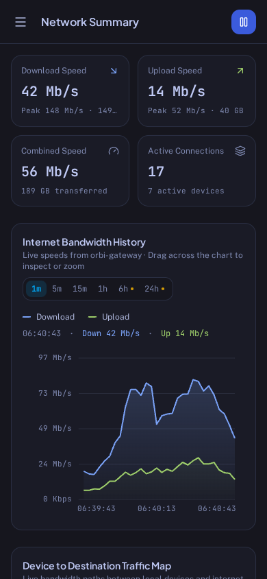

# OrbiFlow

Lightweight, real-time internet traffic monitor and connection inspector built for **Netgear Orbi RBK50** routers running **Voxel firmware**. OrbiFlow streams live kernel connection tracking (`nf_conntrack`) and WAN interface counters from your router to a self-hosted Docker server with an interactive, multi-theme web dashboard.


## Features

- **Real-Time Bandwidth & Interactive Chart Inspection**: Live download and upload throughput graphs across `1m`, `5m`, `15m`, `1h`, `6h`, and `24h` windows. Time spans without recorded telemetry are explicitly marked as *No data*. Drag horizontally across any graph to inspect Average, Peak, and Estimated Transfer breakdowns for Download and Upload or zoom directly into the range.
- **Connection & Local Device Visibility**: Inspect active TCP/UDP/ICMP connections, map local LAN devices via router ARP/DHCP tables, and visualize live traffic paths between devices and internet services.
- **Offline MaxMind GeoIP2 / GeoLite2 Integration**: Drop `GeoLite2-City.mmdb` (or `GeoLite2-Country.mmdb`) and `GeoLite2-ASN.mmdb` into `/config/geoip` or upload `.mmdb` files directly from Server Settings for offline city, country, and ASN/organization enrichment with zero external API calls.
- **Zero-Noise Reverse DNS**: Built-in offline service matching for popular cloud, streaming, and CDN networks. Live DNS PTR lookups are disabled by default and configurable with an in-memory TTL cache when enabled.
- **Persistent `/config` Volume**: Stores user settings and alert rules in `/config/config.json`, optional disk history cache in `/config/cache` (configurable), and MaxMind databases in `/config/geoip`.
- **Appearance & Theme System**: Split **Auto / Dark / Light** appearance selector paired with curated dark palettes (*Obsidian Night*, *Catppuccin Mocha*, *Dracula Pro*, *Nord*, *Tokyo Night*) and light palettes (*Daylight Slate*, *Catppuccin Latte*, *Nord Snow*).
- **Multi-Arch Docker Server Image**: Automated GitHub Actions workflow publishing `linux/amd64`, `linux/arm64`, and `linux/arm/v7` images to GitHub Container Registry (`ghcr.io`).

---

## Screenshots

### Desktop — Active Connections & Inspector Drawer (Dark)


### Desktop — Server Settings & MaxMind MMDB Configuration (Light)


### Mobile — Responsive 2×2 Summary & Bandwidth History
<p align="center">
  
</p>

---

## Architecture

```text
┌──────────────────────────────┐        WebSocket / HTTP JSON (5s poll)        ┌─────────────────────────────────┐
│  Netgear Orbi RBK50 (Voxel)  │ ────────────────────────────────────────────► │      OrbiFlow Docker Server     │
│  /proc/net/nf_conntrack      │                                               │  Express + WS + TelemetryEngine │
│  /sys/class/net/eth0/stats   │                                               │  MaxMind MMDB + Optional rDNS   │
│  /proc/net/arp + DHCP leases │                                               │  /config persistent volume      │
└──────────────────────────────┘                                               └────────────────┬────────────────┘
                                                                                                │ WebSocket + REST
                                                                                                ▼
                                                                               ┌─────────────────────────────────┐
                                                                               │   Web Dashboard (Desktop/Mobile)│
                                                                               └─────────────────────────────────┘
```

---

## Quick Start (Docker Compose)

Run the OrbiFlow server with a single persistent `/config` volume:

```yaml
services:
  orbiflow-server:
    image: ghcr.io/<your-github-username>/orbiflow:latest
    container_name: orbiflow-server
    restart: unless-stopped
    ports:
      - "3000:3000"
    environment:
      - NODE_ENV=production
      - PORT=3000
      - ORBIFLOW_TOKEN=orbi-rbk50-voxel-secret
      - ORBIFLOW_SIMULATOR=false
      - ORBIFLOW_CONFIG_DIR=/config
      - ORBIFLOW_PERSISTENCE=memory
      - ORBIFLOW_CACHE_DIR=/config/cache
      - ORBIFLOW_GEOIP_ENABLED=true
      - ORBIFLOW_GEOIP_DIR=/config/geoip
      - ORBIFLOW_RDNS_ENABLED=false
      - ORBIFLOW_RDNS_SKIP_PRIVATE=true
      - ORBIFLOW_RDNS_TTL_SEC=3600
    volumes:
      - ./config:/config
```

Start the container:

```bash
docker compose up -d
```

Then open `http://<server-ip>:3000` in your browser.

### Building Locally

```bash
docker build -t orbiflow-server .
docker run -d --name orbiflow-server \
  -p 3000:3000 \
  -v $(pwd)/config:/config \
  -e ORBIFLOW_TOKEN=orbi-rbk50-voxel-secret \
  orbiflow-server
```

---

## Persistent `/config` Volume Layout

All user state lives inside `/config` so container upgrades never lose settings, history, or GeoIP databases:

```text
/config/
├── config.json          # Server settings, storage path, rDNS, MaxMind & alert rules
├── cache/               # Optional disk traffic cache (JSONL + state snapshot)
│   ├── state-snapshot.json
│   └── flows-YYYY-MM-DD.jsonl
└── geoip/               # Optional offline MaxMind MMDB databases
    ├── GeoLite2-City.mmdb
    └── GeoLite2-ASN.mmdb
```

---

## MaxMind GeoLite2 Setup (Optional)

OrbiFlow supports offline IP geolocation and ASN/organization lookups using official MaxMind `.mmdb` databases:

1. Create a free [MaxMind GeoLite2](https://dev.maxmind.com/geoip/geolite2-free-geolocation-data) account and download:
   - `GeoLite2-City.mmdb` (or `GeoLite2-Country.mmdb`)
   - `GeoLite2-ASN.mmdb`
2. Either copy the `.mmdb` files into your mounted `./config/geoip/` folder and click **Reload Databases** in **Server Settings**, or upload them directly using **Upload .mmdb File** in the UI.
3. Once loaded, active connections and the **Connection Details** drawer automatically display each remote endpoint's city/country and network operator (`ASxxxxx · Organization`), and the Connections search bar matches location and ASN fields.

---

## Netgear Orbi RBK50 (Voxel Firmware) Router Agent

Open the **Router Agent** tab inside the web dashboard to generate pre-configured scripts with your Docker server IP and shared token. Three lightweight agents are provided:

1. **Python 3 WebSocket (`orbi_probe.py`)** — Recommended when Entware is installed (`opkg install python3-light`). Uses Python stdlib only with built-in RFC 6455 WebSocket framing and 5s polling.
2. **BusyBox Ash (`orbi-probe.sh`)** — Zero extra packages required on stock Voxel firmware (`awk` + `curl`).
3. **Native C (`orbi-wan-probe.c`)** — Minimal-footprint `armv7l` binary for IPQ4019 (<1.2 MB RSS).

Enable Netfilter per-flow byte accounting on the router before starting the agent:

```sh
ssh root@192.168.1.1
echo 1 > /proc/sys/net/netfilter/nf_conntrack_acct
```

---

## Environment Variables

| Variable | Default | Description |
| --- | --- | --- |
| `PORT` | `3000` | HTTP & WebSocket server port |
| `ORBIFLOW_TOKEN` | `orbi-rbk50-voxel-secret` | Shared authentication token required for router ingest endpoints |
| `ORBIFLOW_SIMULATOR` | `true` (dev) / `false` (Docker) | Built-in simulated RBK50 traffic generator when no live router agent is connected |
| `ORBIFLOW_CONFIG_DIR` | `/config` | Directory storing persistent `config.json` |
| `ORBIFLOW_PERSISTENCE` | `memory` | Traffic history storage mode (`memory` or `disk`) |
| `ORBIFLOW_CACHE_DIR` | `/config/cache` | Directory for disk history snapshots and JSONL logs |
| `ORBIFLOW_GEOIP_ENABLED` | `true` | Enable offline MaxMind MMDB lookups |
| `ORBIFLOW_GEOIP_DIR` | `/config/geoip` | Folder scanned for `.mmdb` files |
| `ORBIFLOW_GEOIP_CITY_DB` | *(auto-detected)* | Explicit path override for City/Country `.mmdb` |
| `ORBIFLOW_GEOIP_ASN_DB` | *(auto-detected)* | Explicit path override for ASN `.mmdb` |
| `ORBIFLOW_RDNS_ENABLED` | `false` | Enable live DNS PTR lookups for unknown external IPs |
| `ORBIFLOW_RDNS_SKIP_PRIVATE` | `true` | Skip PTR lookups for RFC1918 private addresses |
| `ORBIFLOW_RDNS_TTL_SEC` | `3600` | In-memory reverse DNS cache TTL in seconds |

---

## Local Development

```bash
npm install
npm run dev
```

Run unit tests and type checks:

```bash
npx tsx --test src/lib/*.test.ts
npm run lint
npm run build
```
