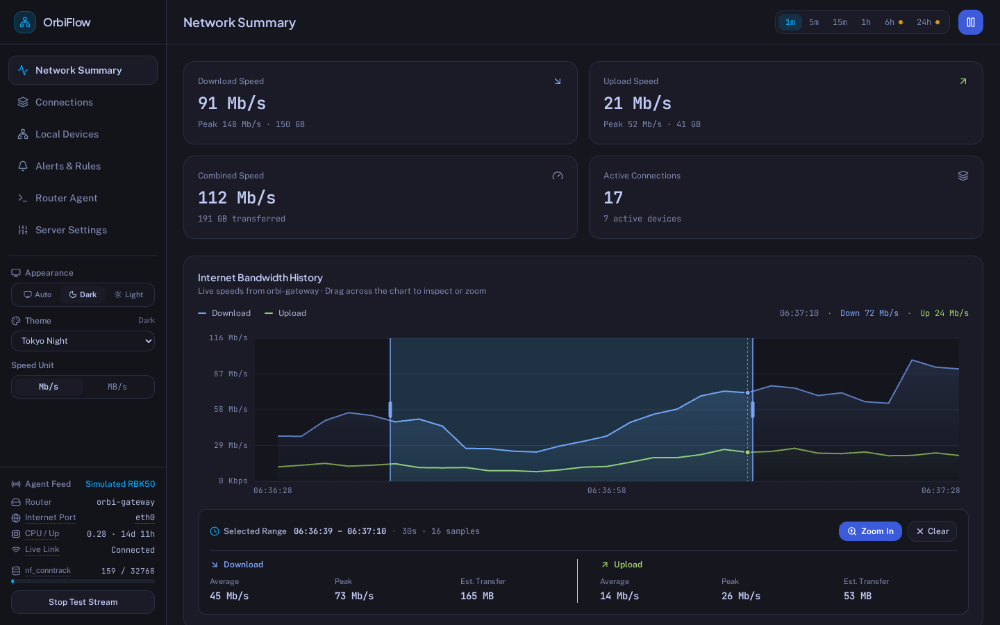
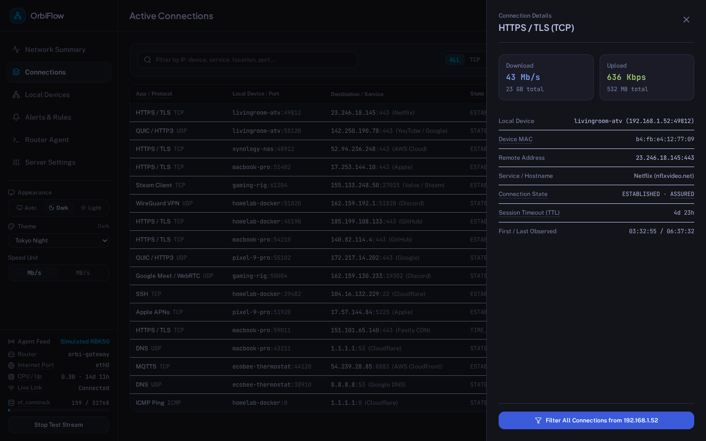

# OrbiFlow

Lightweight, real-time internet traffic monitor and connection inspector for Linux routers. OrbiFlow streams live kernel connection tracking (`nf_conntrack`) and WAN interface counters from your router to a self-hosted non-root Docker server with an interactive, multi-theme web dashboard and push alerts.



## Features

- **Real-Time Bandwidth & Interactive Chart Inspection**: Live download and upload throughput graphs across `1m`, `5m`, `15m`, `1h`, `6h`, and `24h` windows. Time spans without recorded telemetry are explicitly marked as *No data*. Drag horizontally across any graph to inspect Average, Peak, and Estimated Transfer breakdowns or zoom directly into the range.
- **Connections & Device Visibility**: Inspect active TCP/UDP/ICMP connections, resolve local devices via ARP/DHCP/LAN PTR, detect IEEE 802.3 randomized (Private) MAC addresses with passive traffic hints, assign persistent custom device aliases, and visualize live traffic paths between local devices and internet services.
- **Expanded Alerts with ntfy & Telegram Notifications**: Built-in alert rules for WAN download/upload/combined bandwidth, per-device bandwidth & connection spikes, total connections, new LAN devices, agent offline events, and router CPU load / memory usage — with direct server-side push notifications to **ntfy** (ntfy.sh or self-hosted) and **Telegram**.
- **Auto-Randomized Shared Agent Token**: On first start, the server automatically generates a cryptographically random token (`of_...`) stored in `/config/config.json` to authenticate snapshots from your router agent (`X-Probe-Token`) so untrusted LAN devices cannot spoof traffic data.
- **Persistent `/config` Volume & Non-Root Container**: Runs as non-root (`PUID:PGID`, fixing `/config` file ownership on startup) and uses only `PUID`, `PGID`, and `TZ` environment variables.
- **Appearance & Theme System**: Split **Auto / Dark / Light** appearance selector paired with curated dark palettes (*Obsidian Night*, *Catppuccin Mocha*, *Dracula Pro*, *Nord*, *Tokyo Night*) and light palettes (*Daylight Slate*, *Catppuccin Latte*, *Nord Snow*).
- **Multi-Arch Docker Server Image**: Automated GitHub Actions workflow publishing `linux/amd64` and `linux/arm64` images to GitHub Container Registry (`ghcr.io`).

---

## Screenshots

### Desktop — Connections & Inspector Drawer (Dark)


### Mobile — Responsive 2×2 Summary & Live Bandwidth
<p align="center">
  
</p>

---

## Architecture

```text
┌──────────────────────────────┐        WebSocket / HTTP JSON (5s poll)        ┌─────────────────────────────────┐
│         Linux Router         │ ────────────────────────────────────────────► │      OrbiFlow Docker Server     │
│  /proc/net/nf_conntrack      │                                               │  Express + WS + TelemetryEngine │
│  /sys/class/net/<wan>/stats  │                                               │  Alerts (ntfy + Telegram)       │
│  /proc/net/arp + DHCP leases │                                               │  /config persistent volume      │
└──────────────────────────────┘                                               └────────────────┬────────────────┘
                                                                                                │ WebSocket + REST
                                                                                                ▼
                                                                               ┌─────────────────────────────────┐
                                                                               │   Web Dashboard (Desktop/Mobile)│
                                                                               └─────────────────────────────────┘
```

---

## Quick Start (Docker Compose)

Run the OrbiFlow server as a non-root container with a single persistent `/config` volume. The container only uses `PUID`, `PGID`, and `TZ` environment variables—all application settings (shared agent token, storage mode, device aliases, alert rules, and ntfy/Telegram channels) are stored in `/config/config.json`:

```yaml
services:
  orbiflow:
    image: ghcr.io/agneevx/orbiflow:latest
    container_name: orbiflow-server
    restart: unless-stopped
    ports:
      - "3000:3000"
    environment:
      - PUID=1000
      - PGID=1000
      - TZ=UTC
    volumes:
      - ./config:/config
```

Start the container:

```bash
docker compose up -d
```

Then open `http://<server-ip>:3000` in your browser.

### Building Locally

```bash
docker build -t orbiflow-server .
docker run -d --name orbiflow-server \
  -p 3000:3000 \
  -e PUID=1000 \
  -e PGID=1000 \
  -e TZ=UTC \
  -v $(pwd)/config:/config \
  orbiflow-server
```

On startup, the entrypoint repairs ownership of any mismatched files inside `/config` to `PUID:PGID` and drops privileges via `su-exec` before launching Node.js. You can verify the active runtime UID/GID in container logs or via `GET /api/health`.

---

## Persistent `/config` Volume Layout

All user state and server settings live inside `/config` so container upgrades never lose settings or history:

```text
/config/
├── config.json          # Randomized shared agent token, storage mode/path, device aliases, alert rules & notification channels
└── cache/               # Optional disk traffic cache (JSONL + state snapshot)
    ├── traffic-state.json
    └── traffic-snapshots.jsonl
```

---

## Router Agent

Open the **Agent** tab inside the web dashboard to generate pre-configured scripts pre-filled with your server IP and randomized shared token. Three lightweight agents are provided:

1. **Python 3 WebSocket (`orbi_probe.py`)** — Works with Python 3 core modules (including Entware `python3-light`, zero `pip` dependencies, no `urllib` or `idna` required).
2. **BusyBox Shell (`orbi-probe.sh`)** — Zero extra packages required (`awk` + `curl`).
3. **Native C Source (`orbi-wan-probe.c`)** — Minimal-footprint C source (<1.2 MB RSS).

Enable Netfilter per-flow byte accounting on your router before starting the agent:

```sh
ssh root@192.168.1.1
echo 1 > /proc/sys/net/netfilter/nf_conntrack_acct
```

---

## Environment Variables

OrbiFlow intentionally uses only standard container user/timezone variables. The Node.js server always drops privileges to run as non-root (`PUID:PGID`, refusing UID `0`) and reads all application configuration from `/config/config.json`.

| Variable | Default | Description |
| --- | --- | --- |
| `PUID` | `1000` | Non-root numeric user ID used to run the server and own `/config` files |
| `PGID` | `1000` | Non-root numeric group ID used to run the server and own `/config` files |
| `TZ` | `UTC` | Container timezone (e.g. `America/New_York`, `Europe/London`, `Asia/Tokyo`) |

---

## Local Development

```bash
npm install
npm run dev
```

Run unit tests and type checks:

```bash
npx tsx --test src/lib/*.test.ts
npm run lint
npm run build
```
